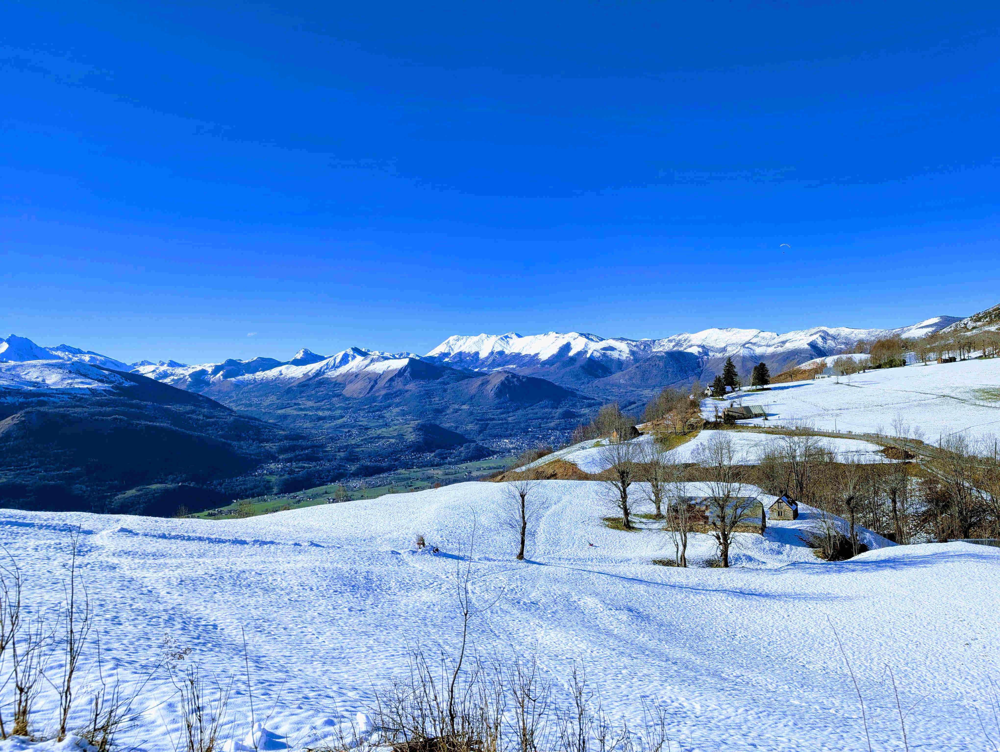
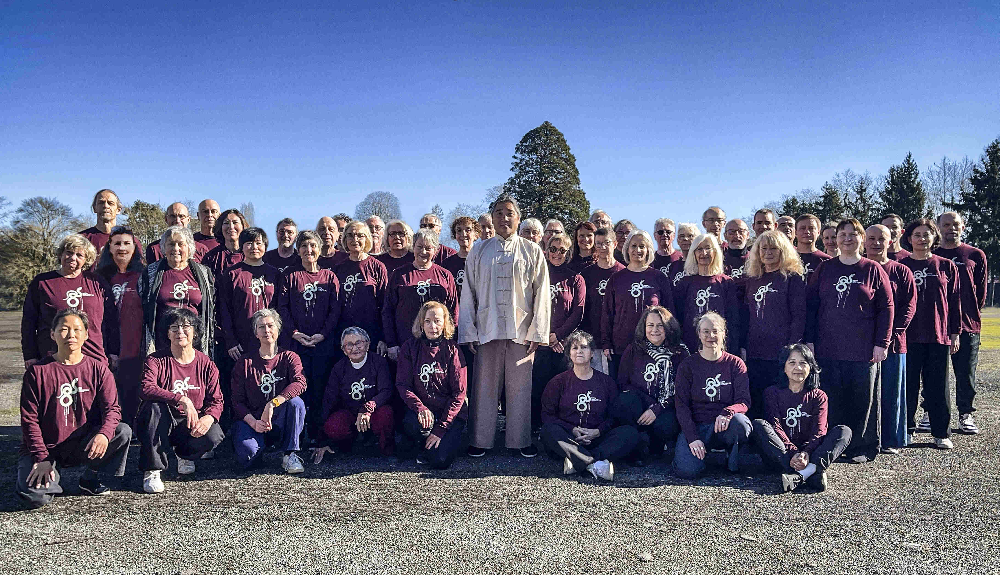
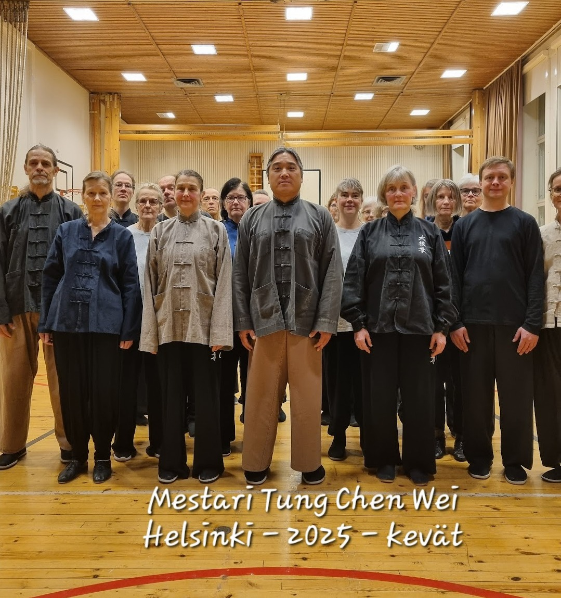

After the winter camp I had only one day to do laundry in home, before I continued to master's new seminar in south of France, Pyrenees, Tarbes. Classes in France are usually big, and this time there were fifty students, few from Italy, two from Finland and most from France including many new. After that master also had a seminar in Helsinki and my teacher in Marienhamn.

Master taught first some fundamentals, that apply to all steps and turnings. Don't drag but pick up your foot, almost like pushing a little and keeping toes pointing down. You should be able to hear the dragging, so stop doing that, don't make a sound. And don't pick up your toes while turning on the foot you have your weight on, don't shift your weight away, but here you should hear the foot turning on the floor.

We went through many movements with exceptional details, and every time I see such corrections, I catch something new to my own practice and teaching. For example, in the beginning of *strike the tiger* kicked foot steps right next to the other foot and to the same direction, and when starting to turn to the second corner lower your left side first and after that open the right side for another strike. Also keep your knee up and toes pointing down while turning in *double wind through the ears*.

Also we measured our steps. In general long step should be about three and a half of your own foot long, and this nicely matches, when you step as long as you can but still stepping softly. Talking about steps there are three different kind of steps: heels on the same line in short step like in *close hands*, narrow step like in *repulse the monkey*, and little wider like in *brush a knee and push*. For push hands the narrow one is correct. You can not turn right, if your step is too wide, and the front foot should be right next to the partner's front foot, no gap in any direction.

Match your energy, like master said, was one theme that I reflected over the classes. He mentioned this specifically to match your energy with partner’s in *tuishou*, but I found many cases, where it’s applicable as well. Like already in the beginning of a class you should line up by yourself, matching your energy right away with the whole group. Keep the lines straight and even. Also with group take the steps at the same time, shift the weight at the same time, and match all movements with others. And the same in single step and three steps, step at the same time, pick up the same foot at the same time, and only if partner does that too. By following your partner's stepping the changes should be easy to catch.

The matching means first and foremost to *ting*, to listen to the partner, even before any contact. Raise the hands at the same time, and take the steps at the same time, just like practicing in a group. People who are just starting to learn *tuishou* are easily too rigid or too loose, but by matching your energy you can help them to get the feeling of connectedness, not forcing or resisting but keeping a light, sticky, deep contact. I continued to match my energy with new students who had hardly practiced push hands at all, but also on the contrary, I pushed with some of the biggest and more experienced partners. It requires a lot of adaptability to be able to match your energy with anyone.

In Marienhamn my teacher also talked about a good connection, and the purpose is to find your own and your partner's center. While making your own movements as big as possible, it's easier to find your own center, and by finding your own center you can help your partner to find your center as well.

I know some people can be a little affraid of the whole idea of touching or being touched, but in my opinion, you can not find the essence of *Tai Chi*, unless you practice with a partner. All people are different, and the more you get experience with them, the easier it is to match with new people.

One thing my teacher also said and resonated strongly with me was: always follow. Even though he used that to match your energy with a group, I realised that it's kind of a mantra for me now a days, because I always follow my teachers.
