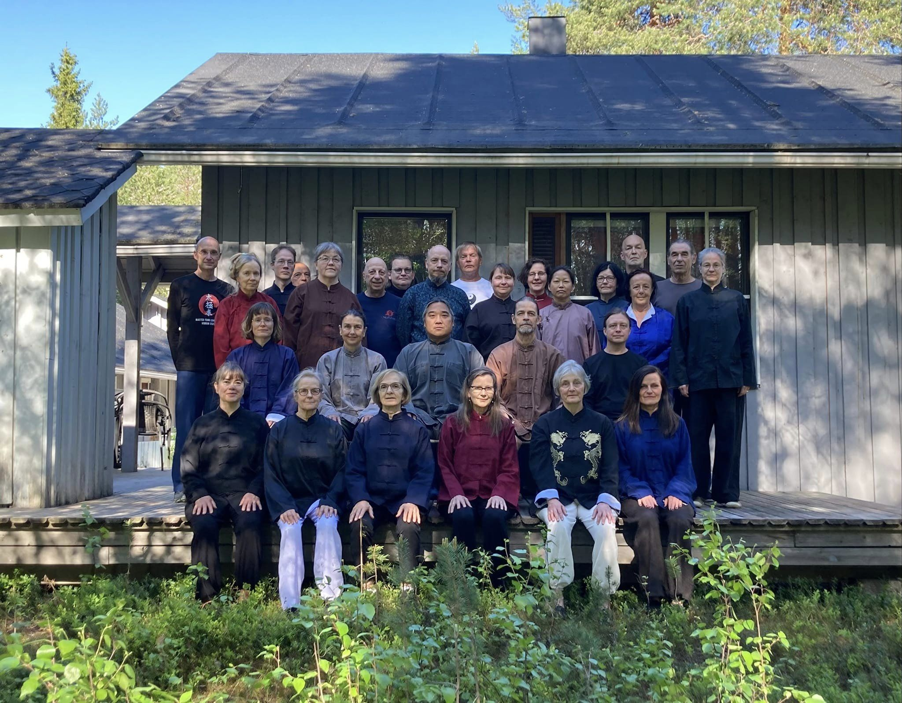
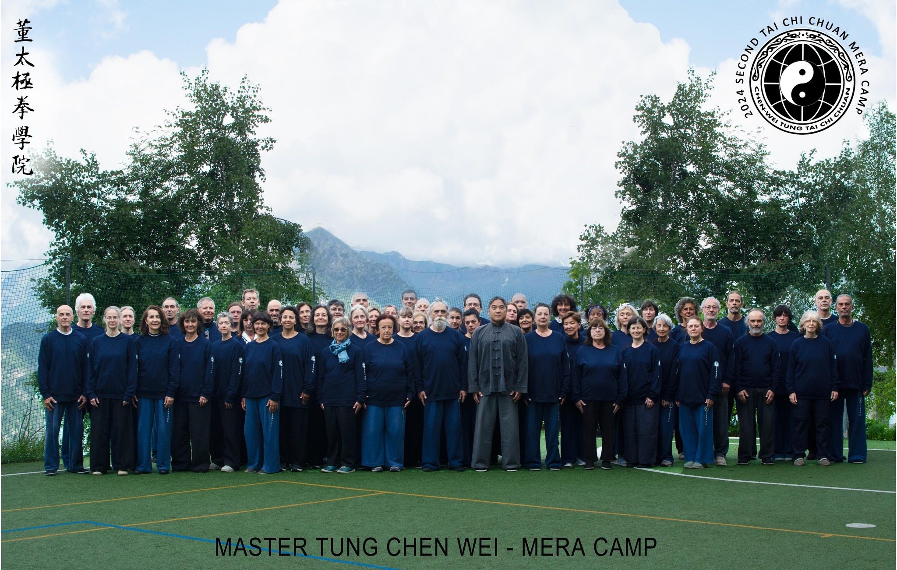

This year we got tragic news just before the European summer camps. One very long time student, who was supposed to be part of the journey got into a fatal accident and passed away with his partner. They both were integrated part of the LA school and the incident had a deep impact on our feelings. Master even dedicated the very first slow set to just passed members of our extended family, and we were also remembering the other ones who have passed away during the last years as well. Many times life turns out to be the least expected.

In Lapland there were a good weather, and it actually always turns out to be better than has been forecasted. We got some big fish and mosquiteos were not that bad.

One new thing we practiced this year was fast set to the left. That was completely unexpected, but I was lucky I had practiced that during the past spring. Otherwise I couldn't have lead the group on a corner. Like master said, if you can do a movement to one side, you should be able to do it on the other side as well. I tried this already about twenty years ago by brushing teeth with left hand, but it's still always a little weird to do your daily routines in different ways. Be aware, no tension, smooth, relaxed, all the time, no change, just like practicing push hands.

With lance we started to practice a new sequence, pushes. First I wondered, if I'd had room to practice it in home indoors, but I can, though I think I should practice it outside to do bigger movements and improve *fa jin*.

Between the camps we had a double class in Helsinki. This time we had many new students and in total biggest class maybe ever with 36 students. Very nice to see the interest growing.

In Mera the weather was a little worse than last year, but it rained only during one class, and actually that made the class very special. It was first time for me to be taught how to practice slow set in a tiny place by doing all movements fully by taking adjusting steps. I have to admit I've used to move some movements between sections to be able to do the whole form in smaller room, but now I learned how to do it in even smaller space. Same, same, but different. You just need to see the difference.

We also practiced new to me double hand push hands with left foot in front stationary and with one step like in three steps. Students who practiced for the first time three steps also demonstrated, what they'd learned. It's always a pleasure to see how master corrects the beginners. Know what you know. We all have our unique backgrounds, first timers or years or even decades of experience, but the movements we practice are always the same. Personally I find it interesting to practice with anyone, and during this two weeks I practiced with over twenty different partners. You can concider this as an open invitation to come to practice with me, when ever you see I'm not already practicing with someone else.
