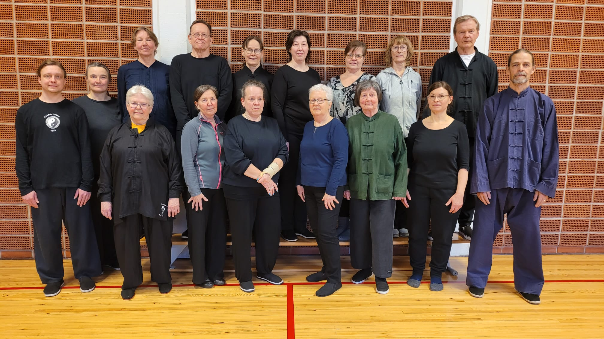
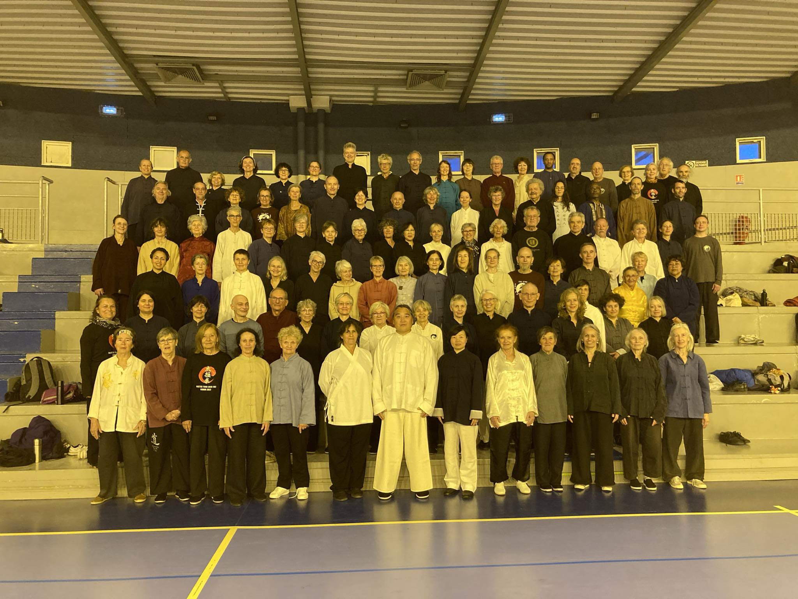

This year master had a new seminar in south of France, Mèze, but before that my own teacher had a seminar in Mariehamn. In Åland, there were snow only in the darkest shade anymore, and summer was further ahead than in the main land Finland.

In the first class some students were new and we focused on the first section of slow set. In second class there were students that had only started fast set and we concentrated on first and second sections. In addition we were practicing continuity in movements and constant turning, never stop even if movement looks like it would, and always turn the body either left or right. The intention never fades, but rather continues further and futher away even when body seems to reach it's limits.

Also movement has always direction that changes only gradually, never forcing against the movement. Movement allows the body to be aware of itself, like without movement it could be hard to even feel your own body. Feel more. And maximal relaxation equals minimal tension, as my teacher said.

Mèze had a very big group, over one hundred students, of which over forty were very first time in master's class. Only time I've previously had taken part into such big class was in Giens the only time I was there five years ago.

The first night we were supposed to have the first class outside, but the wind was too strong, 40 km/h, so lucky we found a very nice and big place just next to the *Village Club*. In the first class we started naturally with slow set and all the first timers demonstrated the first section. *Gong tui*, *zuo tui*, *zhuan yao*, *shang bu*, *song jian*, *ting*. Then we practiced fast set with repeating *cloud hands* and *step back over the tiger*.

I think many people were waiting for us to practice more *tuishou*, so on the second class we started that first as solo, then in distance and later with contact. In general French students seem to be diligent, and I suppose they knew all the drills, but also they seemed to share the same mistake as well. i.e. some lost the connection with other hand a little too early while switching from *ji* to *peng*. Don't lose contact by leaving partner's hand free to do something unexpected.

Mèze was really nice and the atmosphere was more like in a camp, because we all stayed in the same place and had all the meals together with the whole group. Only thing I missed was the seminar to last for a couple of days longer. Well at least we had two extra nights in France with master, and that time was sunny and clear. After I got back home, the winter returned and it was snowing. I'm happy I had a taste of summer, and it won't take long to this year's summer camps anymore.
