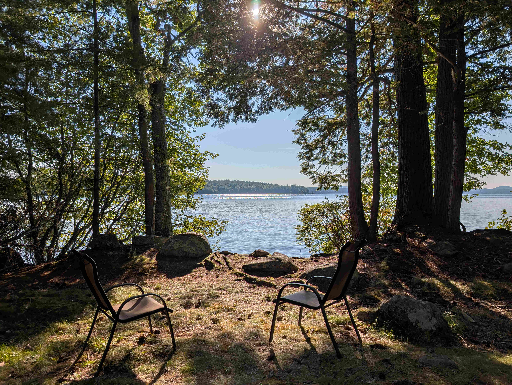
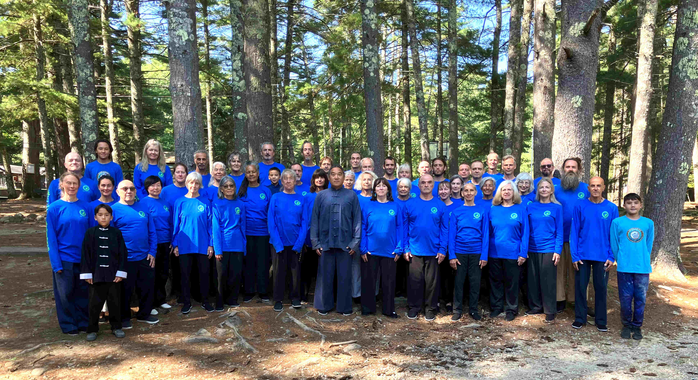
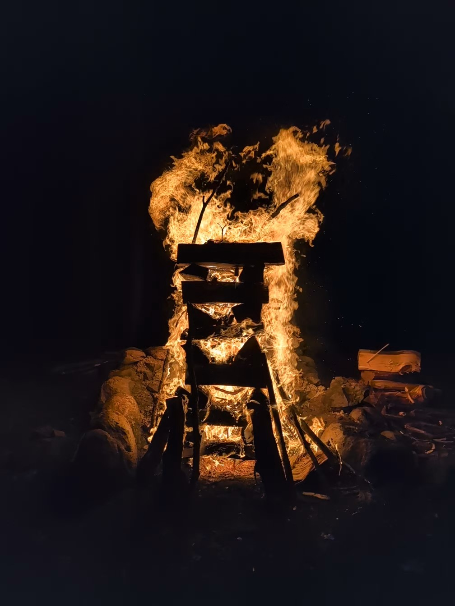

This year I flew to states twelve hours earlier than my friends, so I decided to have a walk around east harbour of Boston. Suddenly out of nowhere I felt pain in my left foot, that had got *march fracture* I'd never had before. I felt it as some weird karma from my last year's accident, and it was a bit mysterious, because it didn't slow me down during the whole week, but after returning home it was swollen and sore. After a few days it's luckily in good shape, though I have to pay attention to it. I think the symptoms can still come and go as with the last year's injury's.

In teaching we focused first learning the names of the movements in Chinese. My Chinese is not very good, so it would require some serious studying for me to remember all those names. But that's not really the point, but to absorb them gradually, and I caught some words that are used in many movements, such as *ma*, *hu*, *pu*, *chio*, and *hou* as personally interesting one. Also what I heard about teaching was, that only 20% should be learning and 80% practicing.

To learn all the names at once would have been too much so master decided we'd focus on the movements from slow set *duilian*. First we practiced just by saying the names by turns with partner without doing the actual movements, and then also with the movements. Chinese names were hard for many people so optionally we used the English ones. Personally I learned many new details starting from the wrist lock, pushing in *ju feng szu pi* and dodging the lifting of kick.

The movements of slow set *duilian*:
1. Brush knee and push, LOU HSI NIU PU
1. Repulse the monkey, TAO NIEN HOU
1. Slanted flying, HSIEH FEI SHIH
1. Play the guitar, SHOU HUI P'I P'A
1. Part the Wild Horse's Mane, YEH MA FEN TSUNG
1. Roll back, LÜ
1. Shoulder strike, KAO
1. Yank, TSAI
1. White crane spreads it's wings, PAI HO LIANG CH'IH
1. Carry tiger back to the mountain, PAO HU KUEI SHAN
1. Retreat and seal, JU FENG SZU PI
1. Fist under the elbow, CHOU TI K'AN CH'UI
1. Elbow strike, CHOU
1. Retreat and kick, HUI SHEN YU TENG CHIO
1. Kick, CHIO

This year we went back to targeting as big fire as possible, and the bonfire was about as tall as master's third son. The flames were beatiful, but we had some misfortune, because the bonfire fell down on the other side, but also fortune as no damage was done. For the next year we thought to build even bigger fire, so we have to refine the building process a little.

After the camp we had three classes in Ashland as usual. There we focused on slow set, first section of fast set and some *kaihe* and *tung jia*. Fast set we practiced especially many times, and once master asked, how many times we'd done it. The correct answer was that, if you remember how many times you've done some practice, it means you haven't practiced enough. Repeat and repeat, one more time, *zai lai yi ci*, and the progress will follow.

This time we didn't do any weapons, but master announced that next year we could start sword from the beginning.
